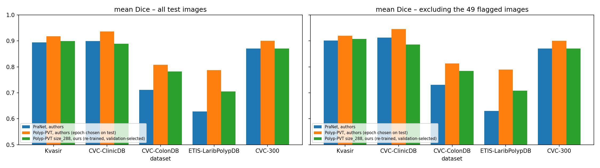

# PolypVision

Automatic polyp segmentation in colonoscopy images: a comparison of
[PraNet](https://github.com/DengPingFan/PraNet) (CNN, MICCAI 2020) and
[Polyp-PVT](https://github.com/DengPingFan/Polyp-PVT) (transformer, 2023).

BME · MSc Deep Learning (VITMMA19) · Fall 2026

## Team

**Team name:** PolypVision

| Member | Neptun code |
|---|---|
| Nour Ounissi | RSPN69 |
| Taha Mersni | K1TO74 |
| Baha Amar | ZXQA2V |

Who does what is in [`docs/Team_Tasks.md`](docs/Team_Tasks.md).

## Project description

Polyp segmentation predicts a pixel-level binary mask of the polyp in a colonoscopy frame. We compare
two representative models from the same research line, PraNet (convolutional, reverse attention) and
Polyp-PVT (Pyramid Vision Transformer backbone). Both are trained on Kvasir-SEG + CVC-ClinicDB and
tested on five public sets (Kvasir, CVC-ClinicDB, CVC-ColonDB, ETIS-LaribPolypDB, CVC-300) with mean
Dice and mean IoU, so they can be compared fairly.

Research question: how do a CNN and a transformer compare in segmentation accuracy, generalisation to
data from other sources, robustness with few labels, and sensitivity to the evaluation protocol?

| Milestone | What | Status | Where |
|---|---|---|---|
| **1 · Reproduce** | Run both official test scripts on the five test sets with the authors' trained weights, score with pysodmetrics, compare with the paper tables; explore the data and prepare train / validation / test loaders | **done** | [`milestone1/`](milestone1/) |
| 2 · Improve | Retrain Polyp-PVT with validation-based checkpoint selection; compare losses, augmentations, and image sizes | **done** — six validation runs, validation-selected `size_288`, one-time test on the five sets | [`notebooks/03_PolypPVT_Retraining.ipynb`](notebooks/03_PolypPVT_Retraining.ipynb), [`notebooks/03b_PolypPVT_Final_Test.ipynb`](notebooks/03b_PolypPVT_Final_Test.ipynb) |
| 3 · Contribute | Other-hospital data, 10/25/50 % labels, failure analysis, evaluation-choice audit | planned | `notebooks/04`–`06` |

Full project outline: [`docs/Project_Documentation.md`](docs/Project_Documentation.md).

## Files in the repository

```
README.md                          this file
requirements.txt                   packages to install on top of Colab's defaults
docs/
  Project_Documentation.md         project idea, research question, approach
  Team_Tasks.md                    members and task split
data/README.md                     dataset notes and the folder layout the models expect (data itself is not committed)
milestone1/
  M1_Reproduce.ipynb               THE notebook of Milestone 1, self-contained (see "How to run")
  prepare_data.py                  Python script: data exploration, train / validation / test split, PyTorch datasets and loaders
  README.md                        Milestone 1 write-up: method, results, PraNet/Kvasir investigation, data preparation
  requirements.txt                 what the notebook pip-installs (gdown, pysodmetrics, timm, tabulate)
  results/PraNet_summary.csv       mean Dice / IoU per test set, our maps     (same for Polyp-PVT_summary.csv)
  results/PraNet_per_image.csv     per-image scores                            (same for Polyp-PVT_per_image.csv)
  results/comparison.csv|md        ours vs paper, side by side
  results/authors_maps_check/      evaluator check: the authors' published maps scored with our code
  results/splits.csv               every image with its split (train / val / test), source, size and polyp size
  figures/reproduced_vs_paper.png  bar chart, ours vs paper
  figures/largest_disagreements.png images where the two models disagree most
  figures/data_samples.png         sample images with mask outlines from every split and source
  figures/data_stats.png           polyp size distribution and images per split
notebooks/03_PolypPVT_Retraining.ipynb  Colab notebook for Milestone 2 (six runs, validation selection)
notebooks/03b_PolypPVT_Final_Test.ipynb Colab notebook for the one-time test of the selected size_288 model
notebooks/results/                  M2 executed records, split manifest, validation and audit artifacts
notebooks/results/final_test/       M2 test results: tables, per-image scores, figures, run record
src/metrics.py                     shared pysodmetrics wrapper for Milestones 2 and 3
src/training/m2_pipeline.py        reproducible M2 training and evaluation helpers
notebooks/04..06_*.ipynb            placeholders for Milestone 3 (not undertaken)
```

## Data source and how it is downloaded

All data and weights come from the Google Drive links published in the official READMEs of
[PraNet](https://github.com/DengPingFan/PraNet) and [Polyp-PVT](https://github.com/DengPingFan/Polyp-PVT).
The download cell of the Milestone 1 notebook fetches them with `gdown`; nothing is committed to
this repository.

| What | Content | From |
|---|---|---|
| `TestDataset.zip` | the five test sets: Kvasir 100, CVC-ClinicDB 62, CVC-ColonDB 380, ETIS-LaribPolypDB 196, CVC-300 60 images + masks | PraNet README |
| `TrainDataset.zip` | Kvasir-SEG 900 + CVC-ClinicDB 550 training images + masks (not needed for Milestone 1) | PraNet README |
| `PraNet-19.pth` | PraNet trained weights | PraNet README |
| `PolypPVT.pth` | Polyp-PVT trained weights | Polyp-PVT README §4.7 |
| `pvt_v2_b2.pth` | PVTv2-B2 ImageNet backbone (Polyp-PVT's constructor loads it even at test time) | Polyp-PVT README §4.3 |
| authors' prediction maps | used only to check our evaluator | both READMEs |

The cell caches the zips and weights in a work folder (your Google Drive when `USE_DRIVE = True`),
unzips to local disk, removes `__MACOSX` folders, and fails loudly if any test set does not have the
expected number of images and masks. One copy of `TestDataset` is shared by both models, so they are
scored against identical masks.

Original dataset pages: [Kvasir-SEG](https://datasets.simula.no/kvasir-seg/),
[CVC-ClinicDB](https://polyp.grand-challenge.org/CVCClinicDB/) (research and education use only).
Pretrained weights are the authors' own, unchanged.

**Preparation for training.** `milestone1/prepare_data.py` holds out 10 % of `TrainDataset` as a
validation set (Kvasir at random, CVC-ClinicDB in blocks of consecutive video frames), keeps the five
test sets as the papers use them, and builds PyTorch loaders that return 3×352×352 normalised image
tensors as inputs and 1×352×352 binary masks as outputs (train 1285, val 165, test 798 images). Details
and data figures in [`milestone1/README.md`](milestone1/README.md).

## How to run

The solution is one Jupyter notebook, **`milestone1/M1_Reproduce.ipynb`**, plus the Python script
**`milestone1/prepare_data.py`** that the notebook fetches for its last section (so the notebook needs
nothing else from this repository).

1. Open it in Google Colab:
   [](https://colab.research.google.com/github/ounissinour/PolypVision/blob/main/milestone1/M1_Reproduce.ipynb)
2. Runtime → Change runtime type → GPU (a T4 is enough).
3. Runtime → Run all. The second cell asks to mount Google Drive (set `USE_DRIVE = False` to skip).

About 15 minutes end to end, most of it downloads. The notebook clones the two official repositories
at fixed commits, downloads data and weights, patches the test scripts, runs `MyTest.py` (PraNet) and
`Test.py` (Polyp-PVT), evaluates the prediction maps, scores the authors' published maps as a check,
prints the comparison with the paper tables, draws the figures, and finally explores the data and
builds the train / validation / test loaders. Results and figures are written to `/content/m1` and
copied to the work folder.

To run locally instead, install `requirements.txt` plus PyTorch and OpenCV and run the cells in order
(every step is plain Python or bash). A full CPU run on a Mac takes about 30 minutes, mostly
Polyp-PVT inference.

## Milestone 1 results

Mean Dice / mean IoU on the five test sets, authors' trained models, Colab T4. Paper value in
brackets; full write-up, per-image scores and figures in [`milestone1/README.md`](milestone1/README.md).

| Dataset (n) | PraNet | Polyp-PVT |
|---|---|---|
| Kvasir (100) | 0.894 (0.898) / 0.836 (0.840) | 0.917 (0.917) / 0.864 (0.864) |
| CVC-ClinicDB (62) | 0.899 (0.899) / 0.849 (0.849) | 0.937 (0.937) / 0.889 (0.889) |
| CVC-ColonDB (380) | 0.712 (0.709) / 0.640 (0.640) | **0.808** (0.808) / 0.727 (0.727) |
| ETIS-LaribPolypDB (196) | 0.628 (0.628) / 0.567 (0.567) | 0.787 (0.787) / 0.706 (0.706) |
| CVC-300 (60) | 0.871 (0.871) / 0.797 (0.797) | 0.900 (0.900) / 0.833 (0.833) |

Polyp-PVT matches the paper on every set, including the 0.808 target on CVC-ColonDB. PraNet matches
on four; on Kvasir we get 0.894 instead of 0.898 with the released checkpoint (investigated in the
Milestone 1 README). Scoring the authors' own published prediction maps with our evaluator gives all
ten paper values, so the metric is the papers' metric: mean Dice over 256 thresholds, not Dice at a
single 0.5 threshold, which is 0.003–0.009 higher on every set. An independent CPU re-run gives the
same ten numbers.

## References

- Fan et al., *PraNet: Parallel Reverse Attention Network for Polyp Segmentation*, MICCAI 2020 — [arXiv:2006.11392](https://arxiv.org/abs/2006.11392)
- Dong et al., *Polyp-PVT: Polyp Segmentation with Pyramid Vision Transformers*, 2021/2023 — [arXiv:2108.06932](https://arxiv.org/abs/2108.06932)
- Jha et al., *Kvasir-SEG: A Segmented Polyp Dataset* — [arXiv:1911.07069](https://arxiv.org/abs/1911.07069) · [dataset](https://datasets.simula.no/kvasir-seg/)
- CVC-ClinicDB — [polyp.grand-challenge.org](https://polyp.grand-challenge.org/CVCClinicDB/)
- Evaluation audit (2026) — [arXiv:2607.08203](https://arxiv.org/abs/2607.08203)
- Optional: [MedSAM](https://github.com/bowang-lab/MedSAM)

## Milestone 2 — Improve Polyp-PVT

Milestone 2 is complete: six controlled training runs, validation-based selection, and a one-time test of the selected model (see *Final test* below). The source Colab notebook is [`notebooks/03_PolypPVT_Retraining.ipynb`](notebooks/03_PolypPVT_Retraining.ipynb), and the reusable pipeline is [`src/training/m2_pipeline.py`](src/training/m2_pipeline.py). The executed notebook, validation table, and run provenance are archived under [`notebooks/results/`](notebooks/results/). Milestone 1 material and results remain intact. MedSAM (optional) was not undertaken.

### Validation split and leakage controls

The official training archive contains 900 Kvasir-SEG images and 550 CVC-ClinicDB frames. The M1 materials do not provide verified CVC-ClinicDB video-sequence identifiers, so all 550 ClinicDB frames were retained in training. A fixed-seed (2026) 10% holdout was created from Kvasir-SEG after image/mask pairing, dimension, exact-duplicate, and near-duplicate checks. The resulting split contains 810 Kvasir and 550 ClinicDB training images, plus 90 Kvasir validation images. This gives a Kvasir-only validation estimate; sequence-level ClinicDB validation remains unavailable without verified video IDs.

All six experiment runs used this same split. The five official test datasets were excluded from training, tuning, and checkpoint selection. After validation selection was locked, the test archive was downloaded only for a post-selection overlap audit. The upstream Polyp-PVT test-set checkpoint-selection behavior was bypassed. The final selection was locked using validation dynamic mean Dice (256 thresholds), with validation mean IoU as the tie-breaker. The selected model was then scored once on the five test sets (see *Final test*).

### Post-selection overlap audit

The post-selection audit flagged 49 test images with a nearest training image at 64-bit dHash distance 0–3; none was an exact SHA-256 match. Visual review of all seven contact sheets found several CVC-ClinicDB test/train pairs with the same lesion and camera view across small frame-to-frame changes (for example, stems 353/354 and 429/436). These are consistent with video-sequence overlap, but verified sequence IDs are unavailable, so the sequence assignments remain unconfirmed. Several cross-dataset candidates were visually different images, showing that the dHash threshold alone over-flags similar endoscopy scenes.

The final test evaluator produced no metrics: an earlier invocation stopped at the overlap guard, and the latest notebook attempt failed with `NameError: json is not defined` before entering the evaluator. The validation-selected checkpoint and validation results remain unchanged. Because ClinicDB sequence overlap is unresolved, do not interpret future test scores as an independent sequence-level evaluation until the training/test sequence relationship is resolved. The audit counts, candidate pairs, and review notes are archived in [`notebooks/results/`](notebooks/results/).

### Controlled experiments and validation results

All runs used the official Polyp-PVT architecture and PVT-v2-B2 pretrained backbone, seed 2026, AdamW (learning rate 1e-4, weight decay 1e-4), batch size 8, up to 100 epochs, global gradient-norm clipping at 0.5, and mixed precision. The fixed learning rate follows the notebook configuration. Each comparison changes one factor from the 352-pixel, original structure-loss, no-augmentation baseline. The original two-output structure loss is retained for the baseline; alternative losses are applied to both output heads. Geometric augmentation applies identical right-angle rotations and horizontal/vertical flips to each image/mask pair. Images use bilinear resizing and masks nearest-neighbor resizing. Sizes are multiples of 32; the upstream per-batch multi-scale resizing is omitted in the size comparison.

| Experiment | Input | Loss | Augmentation | Best epoch | Validation mean Dice | Validation mean IoU | Training time | Status |
|---|---:|---|---|---:|---:|---:|---:|---|
| `baseline_352` | 352 | Structure | None | 92 | 0.916565 | 0.866418 | 1 h 32 min | Complete |
| `loss_bce_dice_352` | 352 | BCE + soft Dice | None | 24 | 0.915268 | 0.865554 | 1 h 31 min | Complete |
| `loss_focal_tversky_352` | 352 | Focal Tversky | None | 77 | 0.913884 | 0.861342 | 1 h 31 min | Complete |
| `augment_flip_rotate_352` | 352 | Structure | Paired flips and right-angle rotations | 74 | 0.914234 | 0.864610 | 1 h 34 min | Complete |
| `size_288` | 288 | Structure | None | 100 | **0.919632** | **0.867804** | 1 h 21 min | Complete |
| `size_416` | 416 | Structure | None | 86 | 0.917901 | 0.867589 | 2 h 02 min | Complete |

The validation-selected checkpoint is `MyDrive/PolypVision_M2/runs/size_288/best.pt` in the Colab Drive folder; it was selected at epoch 100. The result is a validation result only, not a test-set result. The full precision values and recorded training seconds are in [`validation_summary.csv`](notebooks/results/validation_summary.csv).

### Colab environment and reproducibility

The executed run used Python 3.13.16, PyTorch 2.14.1+cu130, torchvision 0.29.1+cu130, CUDA 13.0, a Tesla T4 GPU, OpenCV 4.14.0, NumPy 2.4.6, pandas 2.2.3, timm 1.0.31, and pysodmetrics 1.6.2. The official Polyp-PVT repository was pinned to commit `cd71fbf9fcd8c32cc0f33699f4e0186073c64dc4`. The notebook preserves the Colab-provided PyTorch/torchvision stack, mounts Drive for persistent archive/checkpoint/log storage, and extracts images to temporary Colab storage. Epoch checkpoints include optimizer and RNG state and allow resuming after runtime disconnection. The exact runtime, split counts, training settings, validation-selected run, and test-evaluation status are recorded in [`run_provenance.json`](notebooks/results/run_provenance.json).

| M2 status | Result |
|---|---|
| Completed validation experiments | 6 / 6 |
| Validation-selected checkpoint | `size_288/best.pt` (epoch 100) |
| Locked validation mean Dice / mean IoU | 0.919632 / 0.867804 |
| Final evaluation on five official test sets | Done once with the re-trained `size_288` (see below) |

### Final test of the selected model

Notebook: [`notebooks/03b_PolypPVT_Final_Test.ipynb`](notebooks/03b_PolypPVT_Final_Test.ipynb) (executed copy and all outputs in
[`notebooks/results/final_test/`](notebooks/results/final_test/)).

**Checkpoint.** The `size_288/best.pt` found in the shared Drive folder was an epoch-19 save (validation Dice 0.908),
not the locked epoch-100 checkpoint (0.9196); the notebook's validation re-check caught this before any test image was
scored. `size_288` was therefore re-trained with the identical recipe (same split manifest, seed 2026, 100 epochs,
`train_experiment` unchanged). Its validation-selected epoch is **56**, validation Dice **0.9184** / IoU 0.8676
(original locked run: 0.9196 / 0.8678), and re-scoring validation reproduces it exactly. GPU training is not
bit-for-bit deterministic, so this is a faithful re-run, not the identical file.

**Test.** One evaluation on the five sets, same preprocessing as validation, same 256-threshold metric as Milestone 1.
Mean Dice (authors' models: Milestone 1 per-image scores):

| Model | Kvasir | ClinicDB | ColonDB | ETIS | CVC-300 | Mean of 5 |
|---|---:|---:|---:|---:|---:|---:|
| PraNet, authors | 0.894 | 0.899 | 0.712 | 0.628 | 0.871 | 0.801 |
| Polyp-PVT, authors (epoch chosen on test) | 0.917 | 0.937 | 0.808 | 0.787 | 0.900 | 0.870 |
| **Polyp-PVT `size_288`, ours (validation-selected)** | **0.899** | **0.889** | **0.782** | **0.706** | **0.871** | **0.829** |

Mean IoU of our model: 0.846 / 0.835 / 0.703 / 0.625 / 0.801 (mean 0.762).

- Our validation-selected Polyp-PVT beats PraNet on average (+0.028), mostly on the unseen hospitals
  (ColonDB +0.070, ETIS +0.078).
- It is 0.041 below the authors' Polyp-PVT. Likely causes: the authors' epoch was chosen on the test sets (optimistic),
  our recipe omits the official multi-scale training and uses batch 8 and 288 px, and the 90-image validation set is
  noisy (validation Dice moves between 0.90 and 0.918 from epoch to epoch).
- **Overlap check.** Without the 49 flagged near-duplicate test images, our mean Dice is 0.831 (ClinicDB 0.886); for the
  authors' models the scores also rise slightly (Polyp-PVT ClinicDB 0.937 → 0.946). The flagged images do not inflate
  the results ([`final_comparison.md`](notebooks/results/final_test/final_comparison.md)).


