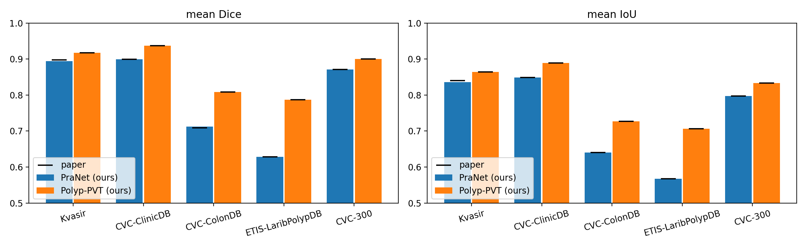

# Polyp segmentation – Milestone 1: reproduce PraNet and Polyp-PVT

Reproduces the published mean Dice and mean IoU of
[PraNet](https://github.com/DengPingFan/PraNet) (CNN, MICCAI 2020) and
[Polyp-PVT](https://github.com/DengPingFan/Polyp-PVT) (transformer, 2023) on the five standard
test sets, using the authors' trained models and the same evaluation definition as their papers.

Part of the team project in [ounissinour/PolypVision](https://github.com/ounissinour/PolypVision);
this repository covers Milestone 1 only.

## Run it

Open `notebooks/M1_Reproduce.ipynb` in Colab with a GPU runtime and run all cells. It

1. clones both official repositories at fixed commits,
2. downloads test/train data and trained weights with `gdown` (`scripts/download.sh`),
3. applies compatibility patches (`scripts/patch_repos.py`),
4. runs `MyTest.py` (PraNet) and `Test.py` (Polyp-PVT) to write prediction maps,
5. computes mean Dice / mean IoU with pysodmetrics (`src/evaluate.py`), on our maps and, as a check,
   on the authors' published maps,
6. compares them with the paper tables (`src/compare.py`) and draws figures.

The notebook is generated from `scripts/build_notebook.py`; edit that and re-run it.

Results land in `results/` (`*_summary.csv`, `*_per_image.csv`, `comparison.csv|md`) and `figures/`.

## Targets

meanDic / meanIoU from the papers (`src/compare.py` holds the sources):

| Dataset (n) | PraNet | Polyp-PVT |
|---|---|---|
| Kvasir (100) | 0.898 / 0.840 | 0.917 / 0.864 |
| CVC-ClinicDB (62) | 0.899 / 0.849 | 0.937 / 0.889 |
| CVC-ColonDB (380) | 0.709 / 0.640 ¹ | **0.808** / 0.727 |
| ETIS-LaribPolypDB (196) | 0.628 / 0.567 | 0.787 / 0.706 |
| CVC-300 (60) | 0.871 / 0.797 | 0.900 / 0.833 |

¹ The Polyp-PVT paper re-reports PraNet on ColonDB as 0.712.

## Reproduced results

Colab, Tesla T4, torch 2.11, official test scripts at test size 352. Mean Dice / mean IoU, paper value
in brackets (full table: `results/comparison.md`):

| Dataset (n) | PraNet | Polyp-PVT |
|---|---|---|
| Kvasir (100) | **0.894** (0.898) / **0.836** (0.840) | 0.917 (0.917) / 0.864 (0.864) |
| CVC-ClinicDB (62) | 0.899 (0.899) / 0.849 (0.849) | 0.937 (0.937) / 0.889 (0.889) |
| CVC-ColonDB (380) | 0.712 (0.709 ¹) / 0.640 (0.640) | **0.808** (0.808) / 0.727 (0.727) |
| ETIS-LaribPolypDB (196) | 0.628 (0.628) / 0.567 (0.567) | 0.787 (0.787) / 0.706 (0.706) |
| CVC-300 (60) | 0.871 (0.871) / 0.797 (0.797) | 0.900 (0.900) / 0.833 (0.833) |

Polyp-PVT reproduces exactly on all five sets, including the 0.808 target on CVC-ColonDB. Polyp-PVT
beats PraNet on every set, most on the unseen ones: +0.096 Dice on CVC-ColonDB and +0.159 on ETIS.

PraNet reproduces exactly on four sets. On Kvasir we get 0.894 instead of 0.898:

- Our maps and the authors' published PraNet maps score the same on CVC-300, ClinicDB, ColonDB and
  ETIS image by image (per-image Dice difference < 0.0001).
- On Kvasir, 92 of 100 images agree; 8 differ by more than 0.01 Dice, two of them by 0.13 and 0.16
  (`cju2mh8t6p07008350e01tx2a`, `cju1amqw6p8pw0993d9gc5crl`).
- The test images and masks are pixel-identical to the original Kvasir-SEG release, re-running PraNet
  on CPU gives the same 0.894 as the T4, and feeding the original JPEGs instead of the PNGs also gives
  0.894. The differing images have no common size.

So the gap is not from the data, the metric or our hardware. Our best explanation is that the authors'
published Kvasir maps were produced with a slightly different checkpoint or software setup than the
released `PraNet-19.pth`; we could not confirm this.

## Evaluator check

Scoring the authors' published prediction maps (PraNet README §3.3, Polyp-PVT README §4.8) with
`src/evaluate.py` reproduces all ten paper values to three decimals
(`results/authors_maps_check/`). The one difference is PraNet on CVC-ColonDB: 0.712, which is
what the Polyp-PVT paper reports; the PraNet paper says 0.709. So any gap between our maps and the
papers comes from inference, not from the metric.

**Single-threshold Dice.** `Dice@0.5` (one 0.5 threshold) is 0.003 to 0.009 higher than the papers'
mean Dice on every set and model. A hand-written 0.5-threshold metric therefore looks like a slight
improvement over the paper when it is not.

## Notes on method

**What "mean Dice" means.** The MATLAB toolbox both papers use (`PraNet/eval/main.m`) binarises each
min-max normalised map at 256 thresholds, computes Dice per image and threshold, averages over images,
then over thresholds. `src/evaluate.py` gets the same number from pysodmetrics (`FmeasureV2` with
`DICEHandler`/`IOUHandler`, dynamic mode). Dice after a single 0.5 threshold is a different, usually
higher number; we report it as `Dice@0.5` only for reference. This matters for the 2026 audit question
in Milestone 3.

**Patches** (`scripts/patch_repos.py`), all compatibility only:
- PraNet `MyTest.py`: `scipy.misc.imsave` (removed from SciPy) → `cv2.imwrite(path, res*255)`,
  as Polyp-PVT's `Test.py` already does; `F.upsample` → `F.interpolate`; weights loaded with `map_location`.
- PraNet `lib/PraNet_Res2Net.py`: `pretrained=False` for the Res2Net backbone, whose ImageNet weights are
  loaded from the authors' local path; `PraNet-19.pth` contains the backbone weights anyway.
- Polyp-PVT `Test.py`: drop the unused `scipy.misc` import, `F.upsample` → `F.interpolate`.
  Its constructor still loads `pretrained_pth/pvt_v2_b2.pth`, so the backbone is downloaded too.

**Data.** One copy of `TestDataset` (from the PraNet README link) is shared by both models, so they are
scored against identical masks. CVC-ClinicDB is used only with the authors' fixed split; if it is ever
re-split, split by video sequence, not by image.
